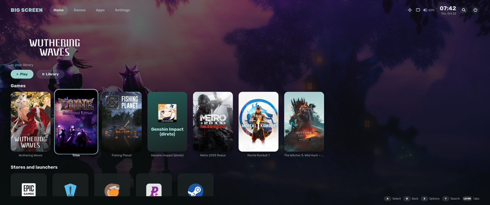
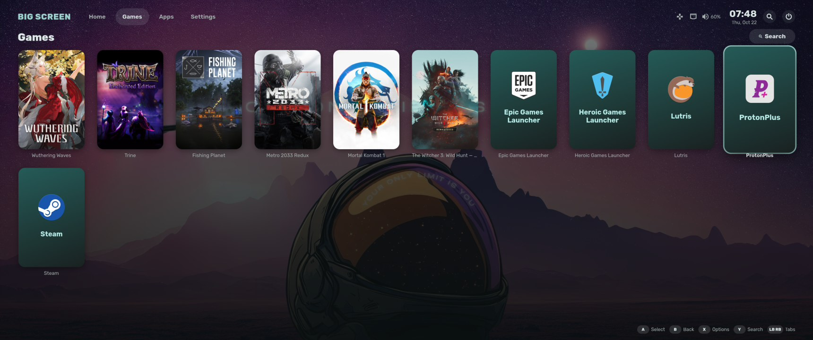
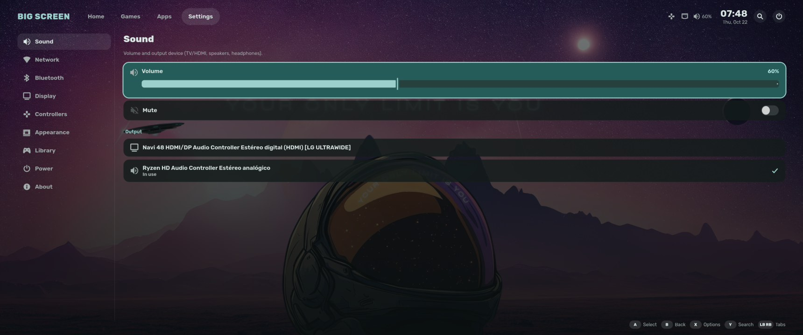
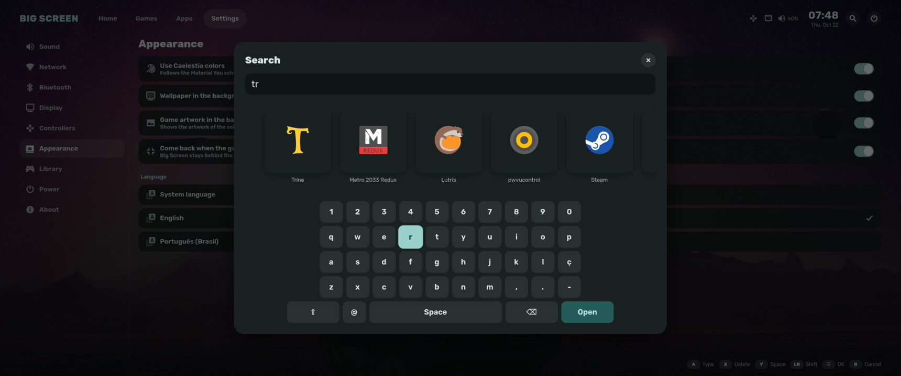

# Caelestia Big Screen

A TV mode for Linux. Press the PS or Xbox button on your controller and your
games and apps open full screen, ready to use from the couch.

Inspired by Plasma Bigscreen and Steam Big Picture, built with GTK 4 for
Hyprland. It follows the colors of [Caelestia Shell](https://github.com/caelestia-dots/shell)
(unofficial project, not affiliated with Caelestia).



## Features

- Opens and closes with the controller's PS or Xbox button
- Steam games with their artwork, plus every installed app
- Artwork for games outside Steam from [SteamGridDB](https://www.steamgriddb.com) (optional, needs a free API key)
- Stays behind the game while you play and comes back when it closes
- Quick menu over games: volume, open windows and power options
- Sound, Wi-Fi, Bluetooth, display and controller settings
- Search with an on-screen keyboard
- Optional login session that starts straight into TV mode
- English and Brazilian Portuguese

| Games | Settings | Search |
|---|---|---|
|  |  |  |

## Install

Dependencies on Arch Linux:

```sh
sudo pacman -S gtk4 libadwaita gtk4-layer-shell python-gobject python-evdev
```

Then:

```sh
git clone https://github.com/maylton/caelestia-bigscreen
cd caelestia-bigscreen
./install.sh --hyprland
```

This starts Big Screen with Hyprland and binds `Super+G` to it. To also add a
"Caelestia Big Screen (TV mode)" session to the login screen, run
`./install.sh --session`.

## Controls

| Button | Action |
|---|---|
| PS / Xbox | Show or hide |
| A | Select |
| B | Back |
| X | Item options |
| Y | Search |
| LB / RB | Switch tabs |
| LT / RT | Volume |
| Start | Quick menu |

## License

[GPL-3.0](LICENSE)
